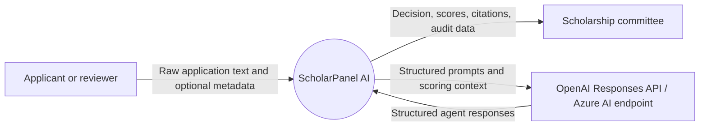
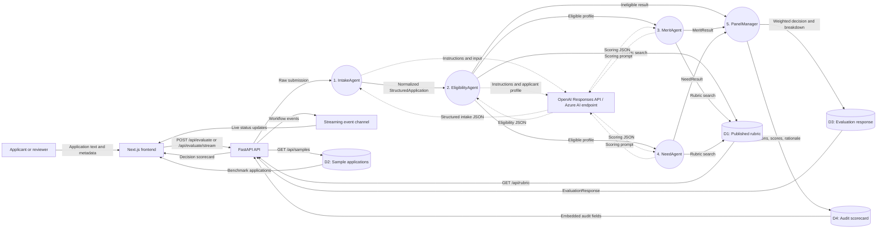

# ScholarPanel AI Data Flow Diagram

This document describes how applicant data moves through ScholarPanel AI from
submission to an auditable scholarship decision.

## Context diagram (Level 0)

## Detailed process diagram (Level 1)

## Process and data-store definitions

| ID | Element | Responsibility |
|---|---|---|
| 1 | `IntakeAgent` | Extracts raw application content into `StructuredApplication`. |
| 2 | `EligibilityAgent` | Checks five hard Section 1 rules and can terminate the workflow. |
| 3 | `MeritAgent` | Scores academic and achievement criteria out of 100. |
| 4 | `NeedAgent` | Scores financial need criteria out of 100. |
| 5 | `PanelManager` | Applies 55/45 weighting, thresholds, citations, and final decision. |
| D1 | Published rubric | Line-indexed rules `[RUBRIC-L01]` through `[RUBRIC-L44]`. |
| D2 | Sample applications | Pre-built benchmark inputs for award, waitlist, and rejection paths. |
| D3 | Evaluation response | Typed response containing applicant, agent results, decision, and traces. |
| D4 | Audit scorecard | Criterion scores, weighted points, rubric quotes, and justifications. |

## Key data flows

1. **Submission:** The frontend sends raw applicant text and optional metadata
   to the FastAPI evaluation endpoint.
2. **Normalization:** `IntakeAgent` produces a validated
   `StructuredApplication`.
3. **Eligibility gate:** `EligibilityAgent` reads the rubric and returns
   per-rule checks. A failed rule routes directly to `PanelManager` for
   terminal `REJECT`.
4. **Parallel scoring:** An eligible profile fans out to `MeritAgent` and
   `NeedAgent`. Both use rubric criteria and return cited subtotals.
5. **Decision aggregation:** `PanelManager` fans results in, computes
   `(Merit * 0.55) + (Need * 0.45)`, and applies the published thresholds.
6. **Presentation and audit:** The API returns the decision and scorecard;
   the streaming endpoint additionally sends live workflow events to the UI.

## Trust and execution boundaries

- **Browser boundary:** The Next.js frontend communicates with the backend over
  HTTP and SSE.
- **Backend boundary:** FastAPI owns validation, orchestration, deterministic
  calculations, and rubric access.
- **Model boundary:** Cloud model calls receive prompts and application
  context; agent outputs are parsed into Pydantic models where applicable.
- **Fallback boundary:** If model configuration or parsing fails, local
  deterministic agent logic is used where implemented.
- **Audit boundary:** Final decisions retain rubric line IDs, quoted rubric
  text, score justifications, and workflow traces for review.

## Source mapping

- API and external flows: `backend/app/main.py`
- Workflow sequencing and fan-out: `backend/app/workflows/evaluation_workflow.py`
- Agent contracts: `backend/app/schemas.py`
- Rubric data and search: `backend/data/published_rubric.md` and
  `backend/app/rag/`
- Frontend transport: `frontend/src/lib/api.ts`

